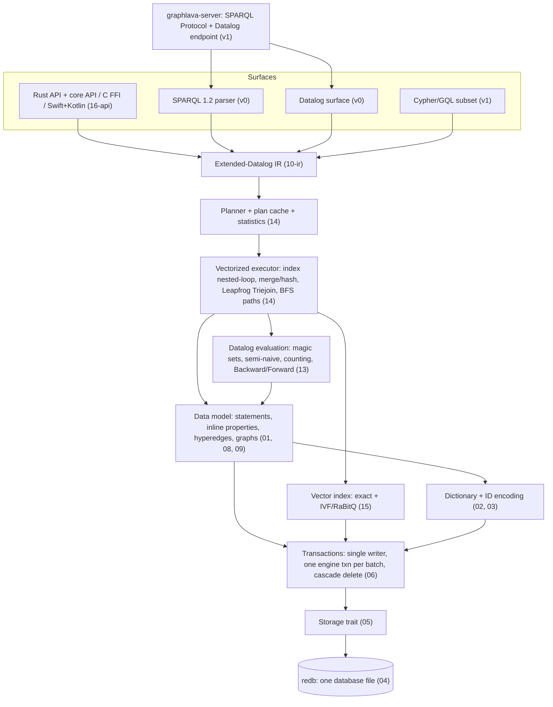

# graphlava overview

graphlava is an embedded, mutable, current-state-only metagraph database in Rust, tuned for agent memory: many small transactions, value overwrites, point lookups and short traversals.

- defines:: [[01-data-model]]
- defines:: [[02-id-encoding]]
- defines:: [[03-dictionary]]
- defines:: [[04-physical-layout]]
- defines:: [[05-storage-trait]]

## Purpose

This file is the entry point to the specifications: what graphlava is for, what it is not, how its layers fit, and where each layer is specified. The project is named graphlava ([[adr:0031]]); older records use its working name, `meta-core`.

The glossary lives in `CONTEXT.md` at the repository root. Terms in **bold** below (Statement, Graph, Hyperedge, Inline property, Promotion, Chunk, Scope, Derived fact, Owner process, Durability level, Multi predicate, Functional predicate, Owned literal, Batch, Write request, Partitioned graph) have the meaning given there and nowhere else.

Decisions are numbered records in `docs/adr/`; each spec lists the records it explains in its `specs:` frontmatter and as `follows_from` edges.

## Goals

The goals are ordered: when two conflict, the earlier one wins. Every performance goal is checked by a benchmark in [[17-benchmarks]].

1. **Performance on the agent-memory mix.** Small write transactions, frequent value overwrites, point lookups, 2–3 hop traversals and star patterns. Targets are "to be measured" until [[17-benchmarks#Engine bake-off]] reports.
2. **Mutable current state.** No transaction time, no valid time, no history. Updating a **Statement** keeps its ID ([[01-data-model#Statements]]).
3. **All four metagraph kinds**: statements about statements, n-ary **Hyperedges**, nested **Graphs**, and a meta-model stored as a graph ([[01-data-model#Metagraph kinds]]).
4. **One query core.** SPARQL 1.2 and Datalog in v0, a Cypher/GQL subset in v1, all compiled to one extended-Datalog IR ([[10-ir]]).
5. **Built-in reasoning and vectors.** Datalog rules and a scope-aware vector index (exact search for small scopes, IVF lists with RaBitQ codes for large ones) inside the engine ([[13-datalog]], [[15-vector-index]]).
6. **Five platforms.** Linux, macOS, Windows, iOS and Android, with one portable file format ([[07-platforms]]).
7. **Scale.** 10M to 1B statements per database file on desktop; about 1–5 GB files on phones (to be measured).

## Non-goals

These are out of scope on purpose. A feature request that needs one of them belongs to another product or to a later, separately decided extension.

<non-goal>

Time travel, audit history and bitemporality. That is the job of the sibling project tiramemsu; graphlava shares no log format with it.

</non-goal>

<non-goal>

Several OS processes opening one file at once. One **Owner process** holds the file; other processes go through IPC or the server crate ([[adr:0002]]).

</non-goal>

<non-goal>

Distributed operation, replication and clustering.

</non-goal>

<non-goal>

Full-text search in the core. It may come as an extension.

</non-goal>

## Architecture

graphlava is a stack of layers in one process. Each layer only calls the layer below; the IR is the single meeting point of all query surfaces, and the `Storage` trait is the only place that knows the engine.

### Data flow of one query

A query is parsed by its surface, lowered to the IR, planned against current statistics and existing orderings, and executed on batches of `u64` IDs. Strings are decoded from the dictionary only at final projection.

### Data flow of one write

A write transaction runs in the owner process under the single writer.

It interns new terms, routes each statement by object kind (literal to an inline property, anything else to the orderings), applies cascades, maintains materialized rules within their budget, and joins the open **Batch**, which commits once at the strongest **Durability level** among its requests ([[06-transactions-durability#Group commit]]). Requests from other processes arrive as one-shot **Write requests** ([[16-api#Write requests]]).

## Spec map

Each file below specifies one layer; v0 files are written to byte and algorithm depth, v1 and v2 files to interface depth ([[adr:0013]]).

| File | Layer | Depth |
| --- | --- | --- |
| [[01-data-model]] | terms, statements, inline properties, promotion, metagraph kinds | v0 |
| [[02-id-encoding]] | 64-bit ID layout, inline literals, allocation | v0 |
| [[03-dictionary]] | term ↔ ID mapping, interning, sweep | v0 |
| [[04-physical-layout]] | tables, key byte order, v1 and v2 encodings, sizes | v0 / v2 |
| [[05-storage-trait]] | engine abstraction and redb adapter | v0 |
| [[06-transactions-durability]] | MVCC, durability levels, group commit, crash recovery | v0 |
| [[07-platforms]] | per-OS constraints | v0 |
| [[08-hyperedges]] | hyperedge records, incidence, role triples | v0 |
| [[09-graphs]] | chunk membership, scope, nesting, partitioned graphs | v0 |
| [[10-ir]] | extended-Datalog IR | v0 |
| [[11-sparql]] | SPARQL 1.2 mapping and deviations | v0 |
| [[12-cypher]] | Cypher/GQL subset | v1 |
| [[13-datalog]] | Datalog surface and evaluation | v0 / v1 |
| [[14-planner-execution]] | statistics, joins, execution, plan cache | v0 |
| [[15-vector-index]] | scope-aware vector index: exact and IVF/RaBitQ | v1 |
| [[16-api]] | Rust API, FFI, bindings, server | v0 / v1 |
| [[17-benchmarks]] | measurement plan | gate |
| [[18-roadmap]] | milestones | — |
| [[open-questions]] | undecided items | — |
